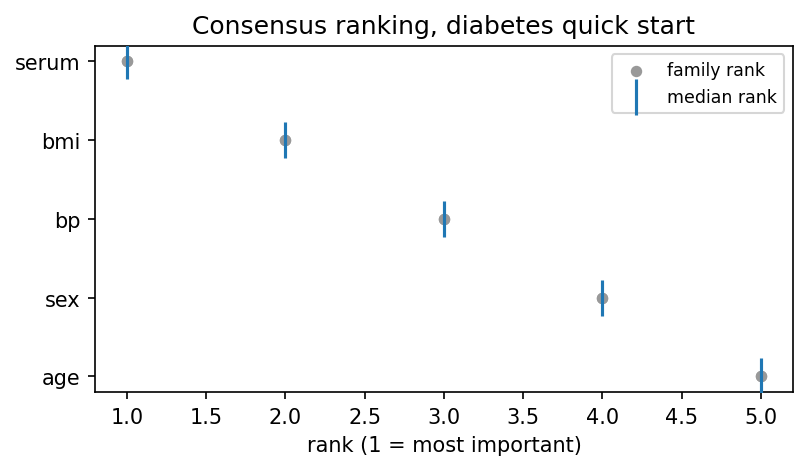

<div align="center">


# FEATRANKER

<p><b>Rank the feature groups your models rely on, checked on held-out data against a dummy baseline and, optionally, shuffled shadow features.</b></p>

<p>A scikit-learn toolkit for developers and data scientists: rank features, check the ranking, and choose a validated subset in a few lines.</p>

<p>
  <a href="https://pypi.org/project/featranker/"></a>
  <a href="https://pypi.org/project/featranker/"></a>
  <a href="https://github.com/CountZero-Error/Featranker/actions/workflows/tests.yml"></a>
  <a href="https://github.com/CountZero-Error/Featranker/blob/main/LICENSE"></a>
</p>

<p>
  <a href="https://github.com/CountZero-Error/Featranker#-01--install"><b>01 Install</b></a> &nbsp;│&nbsp;
  <a href="https://github.com/CountZero-Error/Featranker#-02--quick-start"><b>02 Quick start</b></a> &nbsp;│&nbsp;
  <a href="https://github.com/CountZero-Error/Featranker#-03--how-it-works"><b>03 How it works</b></a> &nbsp;│&nbsp;
  <a href="https://github.com/CountZero-Error/Featranker#-04--docs"><b>04 Docs</b></a> &nbsp;│&nbsp;
  <a href="https://github.com/CountZero-Error/Featranker#-10-minute-recipe"><b>Recipe</b></a> &nbsp;│&nbsp;
  <a href="https://github.com/CountZero-Error/Featranker/releases"><b>Releases</b></a>
</p>

English · [简体中文](https://github.com/CountZero-Error/Featranker/blob/main/README.zh-CN.md)

</div>

```text
┌────────────────────────────────────────────────────────┐
│  FEATRANKER  [ FEATURE RANKING TERMINAL ]              │
├────────────────────────────────────────────────────────┤
│  > MODEL ARRAY ............... 40 UNITS      [ OK ]    │
│  > SEPARATE EVAL SET ......... REQUIRED      [ OK ]    │
│  > DUMMY BASELINE GATE ....... ARMED         [ OK ]    │
│  > RANK CONSENSUS ............ ONLINE        [ OK ]    │
├────────────────────────────────────────────────────────┤
│  READY._                                               │
└────────────────────────────────────────────────────────┘
```

> [!NOTE]
> **FeatRanker 2.0** is a major release: the report helpers deprecated since 1.1 are removed (see [API](https://github.com/CountZero-Error/Featranker/blob/main/docs/api.md)), reports carry `schema_version: 2` with a shipped JSON Schema, and a [new manual](https://github.com/CountZero-Error/Featranker/blob/main/docs/README.md) covers guides, a reference, the CLI and troubleshooting.

FeatRanker trains a set of estimators on training data, measures permutation importance on **separate** evaluation data, and combines each model's ranking into one consensus. Ships with **40 built-in models** (22 classification, 18 regression), or bring your own scikit-learn estimators and pipelines.

## ▍ Why FeatRanker?

<table>
  <tr>
    <td width="33%" valign="top">
      <h4>▣ Held-out by design</h4>
      <code>fit()</code> takes training data; <code>rank_features()</code> takes a separate evaluation set. Keeping them apart is up to you.
    </td>
    <td width="33%" valign="top">
      <h4>▣ Semantic feature groups</h4>
      Permute one-hot or related columns together with one shared row permutation.
    </td>
    <td width="33%" valign="top">
      <h4>▣ Rank consensus</h4>
      Aggregates <i>ranks</i>, one vote per model family. Your own models are separate families unless you map them with <code>families=</code>.
    </td>
  </tr>
  <tr>
    <td width="33%" valign="top">
      <h4>▣ Dummy-baseline gate</h4>
      Only models that strictly beat a dummy vote. If the dummy itself fails, every model votes and the report says so.
    </td>
    <td width="33%" valign="top">
      <h4>▣ Parallel &amp; reproducible</h4>
      <code>n_jobs</code> runs models in parallel. With seeded estimators and a fixed <code>random_state</code> (and <code>shadow_seed</code> when shadows are on), reports match the sequential run.
    </td>
    <td width="33%" valign="top">
      <h4>▣ Auditable reports</h4>
      Scores, raw repeat importances, fitted params, version provenance and structured failures, as strict JSON.
    </td>
  </tr>
</table>

## ▍ 01 · Install

```bash
pip install featranker
```

Requires **Python ≥ 3.10** and scikit-learn ≥ 1.5. Extras:

| Extra | Adds | Install |
|---|---|---|
| `xgboost` | XGBoost models | `pip install "featranker[xgboost]"` |
| `catboost` | CatBoost models | `pip install "featranker[catboost]"` |
| `all` | XGBoost and CatBoost only | `pip install "featranker[all]"` |
| `plot` | matplotlib, for `report.plot()` | `pip install "featranker[plot]"` |
| `shap` | SHAP summaries for `evidence=True` (shap ≥ 0.49); not part of `[all]` | `pip install "featranker[shap]"` |

The `lightgbm` extra was removed in 1.0; install `lightgbm` directly for custom LightGBM estimators.

## ▍ 02 · Quick start

The caller owns splitting and preprocessing. Fit on training data, then rank on a separate evaluation set. This example runs as is:

```python
from sklearn.datasets import load_diabetes
from sklearn.model_selection import train_test_split

from featranker import FeatureRanker

data = load_diabetes()
X_train, X_eval, y_train, y_eval = train_test_split(
    data.data, data.target, test_size=0.3, random_state=0
)

ranker = FeatureRanker(task="reg", group="tree")
ranker.fit(X_train, y_train, feature_names=list(data.feature_names))

report = ranker.rank_features(
    X_eval,
    y_eval,
    scoring="neg_mean_absolute_error",
    feature_groups={"serum": ["s1", "s2", "s3", "s4", "s5", "s6"]},
    random_state=42,
)

for row in report["consensus"]:
    print(f"{row['feature_group']:>6}  median rank {row['median_rank']:.1f}  ({row['n_models']} models)")
```

```text
 serum  median rank 1.0  (7 models)
   bmi  median rank 2.0  (7 models)
    bp  median rank 3.0  (7 models)
   sex  median rank 4.0  (7 models)
   age  median rank 5.0  (7 models)
```



The plot shows each voting family's rank for every feature group, with the median marked and the most important group on top.

Output shown with the `xgboost` and `catboost` extras installed; a core-only install has fewer tree models, so `n_models` is lower. The six blood-serum columns are ranked as one group, and the decision tree scored worse than the dummy baseline, so it stays in the report without a vote. See [Reading the report](https://github.com/CountZero-Error/Featranker/blob/main/docs/report.md#reading-the-report) for what to do next.

For a faster run, `group="fast"` fits one model per family (7 for classification, 5 for regression), about a third of the models; a representative can fail, so the voting families can differ from `"all"` ([details](https://github.com/CountZero-Error/Featranker/blob/main/docs/guide/performance.md)).

Or from the command line:

```bash
featranker --task reg --train-data train.csv --eval-data eval.csv \
  --target target --scoring neg_mean_absolute_error --output report.json
```

> [!TIP]
> NumPy training matrices require `feature_names`; pandas DataFrames keep their column names. See the [manual](https://github.com/CountZero-Error/Featranker/blob/main/docs/README.md) for every parameter, your own models, `n_jobs`, the CLI, and the input contract.

## ▍ 10-minute recipe

From a ranking to a validated subset, on three disjoint sets of rows: train (fit), validation (rank and choose `k`), and test (touched once, at the end). The script has four steps: rank on the validation rows; check support (how many models voted, what `summarize()` flags); choose `k` from the validation ablation curve; validate the chosen groups against all features on the test rows with `ablate()`. It runs as is and uses only scikit-learn models (`group="fast"`), so the output does not depend on optional extras.

```python
from sklearn.datasets import load_diabetes
from sklearn.model_selection import train_test_split

from featranker import FeatureRanker

data = load_diabetes()
names = list(data.feature_names)
X_dev, X_test, y_dev, y_test = train_test_split(data.data, data.target, test_size=0.3, random_state=0)
X_train, X_val, y_train, y_val = train_test_split(X_dev, y_dev, test_size=0.4, random_state=0)

ranker = FeatureRanker(task="reg", group="fast", verbose=False)
ranker.fit(X_train, y_train, feature_names=names)
report = ranker.rank_features(X_val, y_val, scoring="r2", random_state=42)

print("voting models:", report["consensus"][0]["n_models"])
print("findings:", [f["code"] for f in report.summary()])

validation = ranker.ablate(X_train, y_train, X_val, y_val, report, ks=[1, 2, 3, 5, 10])
curve = validation["ablation"]["curve"]
best = max(curve, key=lambda row: row["median_score"])
k = best["k"]
print("chosen groups:", best["feature_groups"], f"(k={k}, validation r2 {best['median_score']:.2f})")

test = ranker.ablate(X_train, y_train, X_test, y_test, report, ks=[k, 10])
scores = {row["k"]: row["median_score"] for row in test["ablation"]["curve"]}
chosen, everything = scores[k], scores[10]
print(f"test r2, chosen {k} groups: {chosen:.2f}   all 10 groups: {everything:.2f}")
```

```text
voting models: 5
findings: ['tied_groups', 'tied_groups', 'within_noise']
chosen groups: ['bmi', 's5', 'bp', 's4', 's3'] (k=5, validation r2 0.46)
test r2, chosen 5 groups: 0.13   all 10 groups: 0.15
```

What this shows:

- Five models voted, but the validation `summarize()` findings say several groups are tied and three are within noise, so the order below the top is not firm.
- The validation curve, which includes `k=10` (all features), picked `k=5`. That choice is frozen before the test rows are touched.
- On the untouched test rows the five groups score r2 0.13 against 0.15 for all ten. Selection did **not** beat using every feature here; a smaller feature set is the only gain left. The drop from validation to test is mostly two small splits, and partly the optimism of choosing `k` on the validation curve (see [Ablation curve](https://github.com/CountZero-Error/Featranker/blob/main/docs/guide/selection.md#ablation-curve)).
- Report the test number, not the validation one. Do not change the choice because of it: that would make the test rows part of the selection.
- To decide again, use new development data (or cross-validate inside the training rows), then test once more on rows not used before.

## ▍ When to use FeatRanker

**Good fit**

- You want to know which feature groups several different models rely on.
- You want a ranking you can check: family consensus, dummy baseline, shadow features, `ablate()` curve.
- You need leakage control, semantic feature groups, and visible model failures.

**Read with care / not a fit**

- **n is tiny.** Rankings from a few dozen evaluation rows are mostly noise; ties and `within_noise` findings are the signal to stop. Use `rank_resampled()` to see how much the order moves.
- **You need causal claims.** Permutation importance describes how fitted models use a feature, not what happens if you change it.
- **You want one model's importance.** The consensus is over many models by design; for a single model use scikit-learn's `permutation_importance` directly.
- **p is very wide and you have no feature groups.** Every column is its own group and the cost grows with the number of groups; group columns, use `group="fast"`, or see the memory and speed notes in the [performance guide](https://github.com/CountZero-Error/Featranker/blob/main/docs/guide/performance.md).
- **You would shrink a real-data feature set with `min_shadow_share=0.5` alone.** In the [real-data study](https://github.com/CountZero-Error/Featranker/blob/main/docs/realdata.md) that rule kept as little as 1% of the features on some datasets and lost held-out score there; choose `k` from the ablation curve with nested cross-validation and check held-out scores.
- **You would trust the shadow p- or q-values as calibrated.** They are experimental; see the [report guide](https://github.com/CountZero-Error/Featranker/blob/main/docs/report.md) and the [benchmark](https://github.com/CountZero-Error/Featranker/blob/main/docs/benchmark.md), which also shows where FeatRanker loses.

## ▍ 03 · How it works

```text
 fit()                 train every model + a dummy baseline (training data)
   │
   ▼
 rank_features()       score every model on the evaluation data
   │
   ▼
 shuffle groups        permute each feature group n_repeats times
   │
   ▼
 rank per model        importance = score drop; rank the groups
   │
   ▼
 dummy gate            only models that beat the dummy vote
   │
   ▼
 one vote per family   near-duplicate models cannot outvote the rest
   │
   ▼
 consensus             median / mean rank per feature group
```

```text
importance = model_score - model_score_after_shuffling
```

Every model uses the same scorer. In the report, the unshuffled score is each model's `evaluation_score`; `baseline_score` is the dummy's score, used only for the vote.

Built-in linear models are wrapped in a `StandardScaler` pipeline fit on training data only; tree models and your own models are used as given.

## ▍ Feature map

| I want to... | Use | Guide |
|---|---|---|
| See why a ranking looks the way it does (with sample weights, correlation and SHAP evidence stay unweighted) | `evidence=True` | [Evidence](https://github.com/CountZero-Error/Featranker/blob/main/docs/guide/noise-and-evidence.md#evidence) |
| Group correlated features | `auto_groups(X)`, `ConsensusSelector(feature_groups="auto")`, `--feature-groups auto` | [auto_groups](https://github.com/CountZero-Error/Featranker/blob/main/docs/guide/selection.md#grouping-correlated-features-with-auto_groups) |
| Measure how stable the ranking is | `rank_resampled()` | [Resampled ranking](https://github.com/CountZero-Error/Featranker/blob/main/docs/guide/validation.md#resampled-ranking) |
| See which families beat shuffled shadows | `shadows=True`, `min_shadow_families` | [Family evidence](https://github.com/CountZero-Error/Featranker/blob/main/docs/guide/noise-and-evidence.md#family-evidence) |
| Test whether the top groups are enough | `ranker.ablate(...)`, `--ablate` | [Ablation curve](https://github.com/CountZero-Error/Featranker/blob/main/docs/guide/selection.md#ablation-curve) |
| Compare repeated runs | `run` block, `summarize()` | [Comparing runs](https://github.com/CountZero-Error/Featranker/blob/main/docs/guide/selection.md#comparing-runs) |
| Select features inside a Pipeline | `ConsensusSelector` | [ConsensusSelector](https://github.com/CountZero-Error/Featranker/blob/main/docs/guide/selection.md#consensusselector-in-a-pipeline) |
| Rank data with missing values | `missing="impute"` | [Missing values](https://github.com/CountZero-Error/Featranker/blob/main/docs/guide/data.md#missing-values) |
| Rank text or category columns | `categorical="auto"` | [Categorical features](https://github.com/CountZero-Error/Featranker/blob/main/docs/guide/data.md#categorical-features) |
| Weight rows (built-in `lda`, `qda`, `pls_regression` cannot take weights and are listed as fit failures) | `sample_weight=`, `--sample-weight` | [Sample weights](https://github.com/CountZero-Error/Featranker/blob/main/docs/guide/data.md#sample-weights) |
| Give custom models named columns (a pipeline that drops the `shadow__` columns is left out of shadow evidence) | `model_input="dataframe"` | [Columns by name](https://github.com/CountZero-Error/Featranker/blob/main/docs/guide/custom-models.md#columns-by-name) |
| Score with several metrics | `scoring=["r2", ...]` | [Several metrics](https://github.com/CountZero-Error/Featranker/blob/main/docs/guide/models-and-scoring.md#several-metrics) |
| Respect grouped or time-ordered rows | `shuffle="within_groups"` with `shuffle_groups=`, `"circular"` | [Dependent rows](https://github.com/CountZero-Error/Featranker/blob/main/docs/guide/validation.md#shuffling-dependent-rows) |
| Speed up evaluation on big data | `max_samples=` | [Fewer evaluation rows](https://github.com/CountZero-Error/Featranker/blob/main/docs/guide/performance.md#fewer-evaluation-rows-max_samples) |
| Fit on large training data | `fit(max_samples=)`, `max_categories=` | [Large data](https://github.com/CountZero-Error/Featranker/blob/main/docs/guide/performance.md#large-data) |

> [!IMPORTANT]
> Ranking belongs inside the training portion of validation. In nested validation, fit and rank on inner folds only, and keep the outer test fold untouched until final evaluation. Never use outer-fold or final-test rankings to choose features. [`ConsensusSelector`](https://github.com/CountZero-Error/Featranker/blob/main/docs/guide/selection.md#consensusselector-in-a-pipeline) does this for you as a scikit-learn `Pipeline` step.

## ▍ 04 · Docs

| Page | Contents |
|---|---|
| [**Recipe**](https://github.com/CountZero-Error/Featranker#-10-minute-recipe) and [**When to use**](https://github.com/CountZero-Error/Featranker#-when-to-use-featranker) | Ranking to a validated subset in one script, and when not to use FeatRanker |
| [**Getting started**](https://github.com/CountZero-Error/Featranker/blob/main/docs/getting-started.md) and [**Concepts**](https://github.com/CountZero-Error/Featranker/blob/main/docs/concepts.md) | Install, a first ranking, and how the ranking is decided |
| [**Guides**](https://github.com/CountZero-Error/Featranker/blob/main/docs/README.md) | Models and scoring, custom models, data (missing values, categories, weights), validation, noise and evidence, selection and ablation, performance |
| [**Command line**](https://github.com/CountZero-Error/Featranker/blob/main/docs/cli.md) | The `featranker` command and every flag |
| [**Reference**](https://github.com/CountZero-Error/Featranker/blob/main/docs/reference.md) | Every public name: signature, parameters, returns, raises |
| [**Troubleshooting**](https://github.com/CountZero-Error/Featranker/blob/main/docs/troubleshooting.md) | Common errors and warnings, and a short FAQ |
| [**Report**](https://github.com/CountZero-Error/Featranker/blob/main/docs/report.md) | How to read the results, resampled (stability) reports, full report structure, ranking and failure rules |
| [**Models**](https://github.com/CountZero-Error/Featranker/blob/main/docs/models.md) | All 40 built-in models, optional extras, known issues |
| [**API**](https://github.com/CountZero-Error/Featranker/blob/main/docs/api.md) | Public API, stability policy, typing, releases |
| [**Benchmark**](https://github.com/CountZero-Error/Featranker/blob/main/docs/benchmark.md) | FeatRanker's selector against Boruta, a permutation-importance rule, and `SelectByShuffling` on synthetic data with known signal, including where it loses |

<details>
<summary>Scope</summary>

`FeatureRanker` does not tune models; it encodes only the columns you mark as `categorical` (inside each fit, with level codes and, for built-in linear models, one-hot) and nothing else; by default it rejects missing values, and `missing="impute"` applies a per-split median imputation inside the built-in models. Its optional SHAP summaries (`evidence=True`) describe how models use features and are not used in the ranking. `ConsensusSelector` performs feature selection inside validation. `rank_resampled()` splits data only to measure ranking stability; it does not evaluate a final model. The one target change it makes is encoding classification labels to `0..n_classes-1` internally (see [Usage](https://github.com/CountZero-Error/Featranker/blob/main/docs/guide/data.md#labels-and-data-handling)). Results depend on the evaluation sample, scorer, estimators, correlated predictors, and permutation design.

</details>

<details>
<summary>Upgrading from 0.3</summary>

The preparation-file workflow was removed in 0.4.0; see the [release notes](https://github.com/CountZero-Error/Featranker/releases/tag/v0.4.0).

</details>

## ▍ Development

```bash
git clone https://github.com/CountZero-Error/Featranker.git
cd Featranker
pip install -e '.[test]'
python -m pytest -q
```

## ▍ License

Released under the [MIT License](https://github.com/CountZero-Error/Featranker/blob/main/LICENSE).

---

<div align="center">
<p><sub><code>■ END OF TAPE ■</code> &nbsp;│&nbsp; Built by <a href="https://github.com/CountZero-Error">CountZero</a> &nbsp;│&nbsp; <a href="https://github.com/CountZero-Error/Featranker#featranker">Rewind ↑</a></sub></p>
</div>
