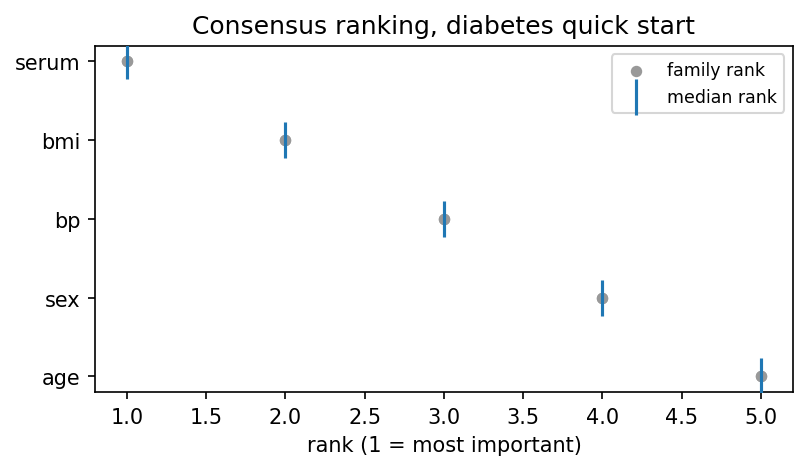

<div align="center">


# FEATRANKER

<p><b>对模型所依赖的特征组进行排名，并在留出数据上对照哑基线（dummy baseline）以及可选的随机打乱的影子特征加以检验。</b></p>

<p>面向开发者和数据科学家的 scikit-learn 工具包：几行代码即可对特征排名、检验排名，并选出经过验证的特征子集。</p>

<p>
  <a href="https://pypi.org/project/featranker/"></a>
  <a href="https://pypi.org/project/featranker/"></a>
  <a href="https://github.com/CountZero-Error/Featranker/actions/workflows/tests.yml"></a>
  <a href="https://github.com/CountZero-Error/Featranker/blob/main/LICENSE"></a>
</p>

<p>
  <a href="https://github.com/CountZero-Error/Featranker/blob/main/README.zh-CN.md#-01--安装"><b>01 安装</b></a> &nbsp;│&nbsp;
  <a href="https://github.com/CountZero-Error/Featranker/blob/main/README.zh-CN.md#-02--快速入门"><b>02 快速入门</b></a> &nbsp;│&nbsp;
  <a href="https://github.com/CountZero-Error/Featranker/blob/main/README.zh-CN.md#-03--工作原理"><b>03 工作原理</b></a> &nbsp;│&nbsp;
  <a href="https://github.com/CountZero-Error/Featranker/blob/main/README.zh-CN.md#-04--文档"><b>04 文档</b></a> &nbsp;│&nbsp;
  <a href="https://github.com/CountZero-Error/Featranker/blob/main/README.zh-CN.md#-10-分钟实践流程"><b>实践流程</b></a> &nbsp;│&nbsp;
  <a href="https://github.com/CountZero-Error/Featranker/releases"><b>发布</b></a>
</p>

[English](https://github.com/CountZero-Error/Featranker/blob/main/README.md) · 简体中文

</div>

```text
┌────────────────────────────────────────────────────────┐
│  FEATRANKER  [ FEATURE RANKING TERMINAL ]              │
├────────────────────────────────────────────────────────┤
│  > MODEL ARRAY ............... 40 UNITS      [ OK ]    │
│  > SEPARATE EVAL SET ......... REQUIRED      [ OK ]    │
│  > DUMMY BASELINE GATE ....... ARMED         [ OK ]    │
│  > RANK CONSENSUS ............ ONLINE        [ OK ]    │
├────────────────────────────────────────────────────────┤
│  READY._                                               │
└────────────────────────────────────────────────────────┘
```

> [!NOTE]
> **FeatRanker 2.0** 是一个主要版本：自 1.1 起弃用的报告辅助函数已被移除（见 [API](https://github.com/CountZero-Error/Featranker/blob/main/docs/api.md)），报告带有 `schema_version: 2` 并随包提供 JSON Schema，另有[新手册](https://github.com/CountZero-Error/Featranker/blob/main/docs/zh-CN/README.md)，涵盖指南、参考、命令行和故障排查。

FeatRanker 在训练数据上训练一组估计器，在**独立的**评估数据上测量置换重要性（permutation importance），并把每个模型的排名合并为一个共识排名。内置 **40 个模型**（22 个分类、18 个回归），也可以使用你自己的 scikit-learn 估计器和管道（Pipeline）。

## ▍ 为什么选择 FeatRanker？

<table>
  <tr>
    <td width="33%" valign="top">
      <h4>▣ 设计上即留出评估</h4>
      <code>fit()</code> 接收训练数据；<code>rank_features()</code> 接收独立的评估集。让两者保持分离由你负责。
    </td>
    <td width="33%" valign="top">
      <h4>▣ 语义特征组</h4>
      对独热编码或相关的列使用同一个行置换，一起置换。
    </td>
    <td width="33%" valign="top">
      <h4>▣ 排名共识</h4>
      聚合的是<i>排名</i>，每个模型族投一票。你自己的模型各自是独立的模型族，除非用 <code>families=</code> 映射它们。
    </td>
  </tr>
  <tr>
    <td width="33%" valign="top">
      <h4>▣ 哑基线门槛</h4>
      只有严格优于哑基线的模型才能投票。如果哑基线本身失败，则所有模型都投票，并且报告会说明这一点。
    </td>
    <td width="33%" valign="top">
      <h4>▣ 并行且可复现</h4>
      <code>n_jobs</code> 并行运行模型。使用带随机种子的估计器、固定的 <code>random_state</code>（开启影子特征时还有 <code>shadow_seed</code>），报告与串行运行一致。
    </td>
    <td width="33%" valign="top">
      <h4>▣ 可审计的报告</h4>
      得分、各次重复的原始重要性、拟合参数、版本溯源和结构化的失败信息，均为严格的 JSON。
    </td>
  </tr>
</table>

## ▍ 01 · 安装

```bash
pip install featranker
```

需要 **Python ≥ 3.10** 和 scikit-learn ≥ 1.5。可选附加项（extras）：

| 附加项 | 增加内容 | 安装 |
|---|---|---|
| `xgboost` | XGBoost 模型 | `pip install "featranker[xgboost]"` |
| `catboost` | CatBoost 模型 | `pip install "featranker[catboost]"` |
| `all` | 仅 XGBoost 和 CatBoost | `pip install "featranker[all]"` |
| `plot` | matplotlib，用于 `report.plot()` | `pip install "featranker[plot]"` |
| `shap` | 用于 `evidence=True` 的 SHAP 摘要（shap ≥ 0.49）；不包含在 `[all]` 中 | `pip install "featranker[shap]"` |

`lightgbm` 附加项已在 1.0 中移除；自定义 LightGBM 估计器请直接安装 `lightgbm`。

## ▍ 02 · 快速入门

数据划分和预处理由调用方负责。先在训练数据上拟合，再在独立的评估集上排名。此示例可直接运行：

```python
from sklearn.datasets import load_diabetes
from sklearn.model_selection import train_test_split

from featranker import FeatureRanker

data = load_diabetes()
X_train, X_eval, y_train, y_eval = train_test_split(
    data.data, data.target, test_size=0.3, random_state=0
)

ranker = FeatureRanker(task="reg", group="tree")
ranker.fit(X_train, y_train, feature_names=list(data.feature_names))

report = ranker.rank_features(
    X_eval,
    y_eval,
    scoring="neg_mean_absolute_error",
    feature_groups={"serum": ["s1", "s2", "s3", "s4", "s5", "s6"]},
    random_state=42,
)

for row in report["consensus"]:
    print(f"{row['feature_group']:>6}  median rank {row['median_rank']:.1f}  ({row['n_models']} models)")
```

```text
 serum  median rank 1.0  (7 models)
   bmi  median rank 2.0  (7 models)
    bp  median rank 3.0  (7 models)
   sex  median rank 4.0  (7 models)
   age  median rank 5.0  (7 models)
```



该图显示每个投票的模型族对每个特征组的排名，并标出中位数，最重要的特征组在最上方。

所示输出是在安装了 `xgboost` 和 `catboost` 附加项时得到的；仅安装核心包时树模型较少，因此 `n_models` 会更低。六个血清列作为一个组排名，决策树的得分比哑基线差，因此它保留在报告中但没有投票。后续该怎么做，见[阅读报告](https://github.com/CountZero-Error/Featranker/blob/main/docs/report.md#reading-the-report)。

若要更快运行，`group="fast"` 每个模型族只拟合一个模型（分类 7 个，回归 5 个），约为模型数的三分之一；代表模型可能失败，因此投票的模型族可能与 `"all"` 不同（[详情](https://github.com/CountZero-Error/Featranker/blob/main/docs/zh-CN/guide/performance.md)）。

或者使用命令行：

```bash
featranker --task reg --train-data train.csv --eval-data eval.csv \
  --target target --scoring neg_mean_absolute_error --output report.json
```

> [!TIP]
> NumPy 训练矩阵需要提供 `feature_names`；pandas DataFrame 会保留其列名。每个参数、自定义模型、`n_jobs`、命令行和输入约定，见[手册](https://github.com/CountZero-Error/Featranker/blob/main/docs/zh-CN/README.md)。

## ▍ 10 分钟实践流程

从排名到经过验证的子集，使用三个互不相交的行集合：训练集（拟合）、验证集（排名并选择 `k`）和测试集（最后只使用一次）。脚本分四步：在验证行上排名；检查支持度（有多少模型投票，`summarize()` 标出了什么）；根据验证集消融曲线选择 `k`；用 `ablate()` 在测试行上对照全部特征验证所选的特征组。脚本可直接运行，且只使用 scikit-learn 模型（`group="fast"`），因此输出不依赖可选附加项。

```python
from sklearn.datasets import load_diabetes
from sklearn.model_selection import train_test_split

from featranker import FeatureRanker

data = load_diabetes()
names = list(data.feature_names)
X_dev, X_test, y_dev, y_test = train_test_split(data.data, data.target, test_size=0.3, random_state=0)
X_train, X_val, y_train, y_val = train_test_split(X_dev, y_dev, test_size=0.4, random_state=0)

ranker = FeatureRanker(task="reg", group="fast", verbose=False)
ranker.fit(X_train, y_train, feature_names=names)
report = ranker.rank_features(X_val, y_val, scoring="r2", random_state=42)

print("voting models:", report["consensus"][0]["n_models"])
print("findings:", [f["code"] for f in report.summary()])

validation = ranker.ablate(X_train, y_train, X_val, y_val, report, ks=[1, 2, 3, 5, 10])
curve = validation["ablation"]["curve"]
best = max(curve, key=lambda row: row["median_score"])
k = best["k"]
print("chosen groups:", best["feature_groups"], f"(k={k}, validation r2 {best['median_score']:.2f})")

test = ranker.ablate(X_train, y_train, X_test, y_test, report, ks=[k, 10])
scores = {row["k"]: row["median_score"] for row in test["ablation"]["curve"]}
chosen, everything = scores[k], scores[10]
print(f"test r2, chosen {k} groups: {chosen:.2f}   all 10 groups: {everything:.2f}")
```

```text
voting models: 5
findings: ['tied_groups', 'tied_groups', 'within_noise']
chosen groups: ['bmi', 's5', 'bp', 's4', 's3'] (k=5, validation r2 0.46)
test r2, chosen 5 groups: 0.13   all 10 groups: 0.15
```

结果说明：

- 有五个模型投票，但验证集上 `summarize()` 的发现表明若干特征组并列、三个在噪声范围内，因此第一名之后的顺序并不牢靠。
- 验证曲线包含 `k=10`（全部特征），选出了 `k=5`。这个选择在接触测试行之前就已固定。
- 在未触碰的测试行上，五个特征组的 r2 为 0.13，而全部十个为 0.15。这里选择**没有**胜过使用全部特征；剩下的唯一收益是特征集更小。验证到测试的下降主要来自两个都很小的划分，部分来自在验证曲线上选择 `k` 带来的乐观偏差（见[消融曲线](https://github.com/CountZero-Error/Featranker/blob/main/docs/zh-CN/guide/selection.md#消融曲线)）。
- 报告测试集的数值，而不是验证集的数值。不要因为它而改变选择：那会让测试行成为选择过程的一部分。
- 若要重新决定，请使用新的开发数据（或在训练行内做交叉验证），然后在未用过的行上再测试一次。

## ▍ 何时使用 FeatRanker

**适合的情形**

- 你想知道多个不同的模型依赖哪些特征组。
- 你想要一个可以检验的排名：模型族共识、哑基线、影子特征、`ablate()` 曲线。
- 你需要数据泄漏控制、语义特征组，以及可见的模型失败。

**需谨慎解读 / 不适合的情形**

- **n 很小。** 只有几十行评估数据得出的排名大多是噪声；并列和 `within_noise` 发现就是该停下的信号。可用 `rank_resampled()` 查看顺序变动有多大。
- **你需要因果结论。** 置换重要性描述的是已拟合模型如何使用某个特征，而不是改变该特征会发生什么。
- **你想要单个模型的重要性。** 共识按设计是跨多个模型的；对单个模型请直接使用 scikit-learn 的 `permutation_importance`。
- **p 非常大且没有特征组。** 每一列都是独立的组，成本随组数增长；请对列分组、使用 `group="fast"`，或参阅[性能指南](https://github.com/CountZero-Error/Featranker/blob/main/docs/zh-CN/guide/performance.md)中关于内存和速度的说明。
- **你打算仅凭 `min_shadow_share=0.5` 缩减真实数据的特征集。** 在[真实数据研究](https://github.com/CountZero-Error/Featranker/blob/main/docs/realdata.md)中，该规则在某些数据集上只保留了 1% 的特征，并损失了留出得分；请通过嵌套交叉验证根据消融曲线选择 `k`，并检查留出得分。
- **你打算把影子 p 值或 q 值当作校准过的值。** 它们是实验性的；见[报告指南](https://github.com/CountZero-Error/Featranker/blob/main/docs/report.md)和[基准测试](https://github.com/CountZero-Error/Featranker/blob/main/docs/benchmark.md)，后者也展示了 FeatRanker 表现不佳之处。

## ▍ 03 · 工作原理

```text
 fit()                 训练每个模型和一个哑基线（训练数据）
   │
   ▼
 rank_features()       在评估数据上为每个模型打分
   │
   ▼
 打乱特征组            将每个特征组置换 n_repeats 次
   │
   ▼
 每个模型的排名        重要性 = 得分下降；对特征组排名
   │
   ▼
 哑基线门槛            只有优于哑基线的模型才投票
   │
   ▼
 每个模型族一票        近似重复的模型无法压过其余模型
   │
   ▼
 共识                  每个特征组的中位数 / 平均排名
```

```text
importance = model_score - model_score_after_shuffling
```

每个模型使用相同的评分器。在报告中，未打乱时的得分是每个模型的 `evaluation_score`；`baseline_score` 是哑基线的得分，仅用于投票。

内置线性模型被包装在只用训练数据拟合的 `StandardScaler` 管道中；树模型和你自己的模型按原样使用。

## ▍ 功能一览

| 我想要…… | 使用 | 指南 |
|---|---|---|
| 了解排名为何是这个样子（使用样本权重时，相关性和 SHAP 证据保持不加权） | `evidence=True` | [证据](https://github.com/CountZero-Error/Featranker/blob/main/docs/zh-CN/guide/noise-and-evidence.md#证据) |
| 为相关特征分组 | `auto_groups(X)`、`ConsensusSelector(feature_groups="auto")`、`--feature-groups auto` | [auto_groups](https://github.com/CountZero-Error/Featranker/blob/main/docs/zh-CN/guide/selection.md#用-auto_groups-为相关特征分组) |
| 衡量排名有多稳定 | `rank_resampled()` | [重采样排名](https://github.com/CountZero-Error/Featranker/blob/main/docs/zh-CN/guide/validation.md#重采样排名) |
| 查看哪些模型族胜过被打乱的影子特征 | `shadows=True`、`min_shadow_families` | [模型族证据](https://github.com/CountZero-Error/Featranker/blob/main/docs/zh-CN/guide/noise-and-evidence.md#模型族证据) |
| 检验排名靠前的特征组是否足够 | `ranker.ablate(...)`、`--ablate` | [消融曲线](https://github.com/CountZero-Error/Featranker/blob/main/docs/zh-CN/guide/selection.md#消融曲线) |
| 比较多次重复运行 | `run` 块、`summarize()` | [比较运行](https://github.com/CountZero-Error/Featranker/blob/main/docs/zh-CN/guide/selection.md#比较运行) |
| 在 Pipeline 内选择特征 | `ConsensusSelector` | [ConsensusSelector](https://github.com/CountZero-Error/Featranker/blob/main/docs/zh-CN/guide/selection.md#管道中的-consensusselector) |
| 对含缺失值的数据排名 | `missing="impute"` | [缺失值](https://github.com/CountZero-Error/Featranker/blob/main/docs/zh-CN/guide/data.md#缺失值) |
| 对文本或类别列排名 | `categorical="auto"` | [类别特征](https://github.com/CountZero-Error/Featranker/blob/main/docs/zh-CN/guide/data.md#类别特征) |
| 为行加权（内置的 `lda`、`qda`、`pls_regression` 不能接受权重，会被列为拟合失败） | `sample_weight=`、`--sample-weight` | [样本权重](https://github.com/CountZero-Error/Featranker/blob/main/docs/zh-CN/guide/data.md#样本权重) |
| 为自定义模型提供有列名的输入（丢弃 `shadow__` 列的管道不参与影子证据） | `model_input="dataframe"` | [按名称提供列](https://github.com/CountZero-Error/Featranker/blob/main/docs/zh-CN/guide/custom-models.md#按名称选择列) |
| 用多个指标评分 | `scoring=["r2", ...]` | [多个指标](https://github.com/CountZero-Error/Featranker/blob/main/docs/zh-CN/guide/models-and-scoring.md#多个指标) |
| 兼顾分组或按时间排序的行 | `shuffle="within_groups"` 配合 `shuffle_groups=`，`"circular"` | [相依的行](https://github.com/CountZero-Error/Featranker/blob/main/docs/zh-CN/guide/validation.md#打乱存在依赖的行) |
| 在大数据上加快评估 | `max_samples=` | [更少的评估行](https://github.com/CountZero-Error/Featranker/blob/main/docs/zh-CN/guide/performance.md#更少的评估行max_samples) |
| 在大型训练数据上拟合 | `fit(max_samples=)`、`max_categories=` | [大数据](https://github.com/CountZero-Error/Featranker/blob/main/docs/zh-CN/guide/performance.md#大数据) |

> [!IMPORTANT]
> 排名应放在验证的训练部分之内。在嵌套验证（nested validation）中，只在内层折上拟合和排名，并在最终评估之前保持外层测试折不被触碰。切勿使用外层折或最终测试集的排名来选择特征。[`ConsensusSelector`](https://github.com/CountZero-Error/Featranker/blob/main/docs/zh-CN/guide/selection.md#管道中的-consensusselector) 作为 scikit-learn `Pipeline` 的一个步骤替你完成这一点。

## ▍ 04 · 文档

| 页面 | 内容 |
|---|---|
| [**实践流程**](https://github.com/CountZero-Error/Featranker/blob/main/README.zh-CN.md#-10-分钟实践流程)和[**何时使用**](https://github.com/CountZero-Error/Featranker/blob/main/README.zh-CN.md#-何时使用-featranker) | 在一个脚本中从排名到经过验证的子集，以及何时不应使用 FeatRanker |
| [**快速入门**](https://github.com/CountZero-Error/Featranker/blob/main/docs/zh-CN/getting-started.md)和[**概念**](https://github.com/CountZero-Error/Featranker/blob/main/docs/zh-CN/concepts.md) | 安装、第一次排名，以及排名是如何确定的 |
| [**指南**](https://github.com/CountZero-Error/Featranker/blob/main/docs/zh-CN/README.md) | 模型与评分、自定义模型、数据（缺失值、类别、权重）、验证、噪声与证据、选择与消融、性能 |
| [**命令行**](https://github.com/CountZero-Error/Featranker/blob/main/docs/zh-CN/cli.md) | `featranker` 命令及其所有标志 |
| [**参考**](https://github.com/CountZero-Error/Featranker/blob/main/docs/zh-CN/reference.md) | 每个公开名称：签名、参数、返回值、异常 |
| [**故障排查**](https://github.com/CountZero-Error/Featranker/blob/main/docs/zh-CN/troubleshooting.md) | 常见错误和警告，以及简短的常见问题 |
| [**报告**](https://github.com/CountZero-Error/Featranker/blob/main/docs/report.md) | 如何阅读结果、重采样（稳定性）报告、完整报告结构、排名与失败规则 |
| [**模型**](https://github.com/CountZero-Error/Featranker/blob/main/docs/models.md) | 全部 40 个内置模型、可选附加项、已知问题 |
| [**API**](https://github.com/CountZero-Error/Featranker/blob/main/docs/api.md) | 公开 API、稳定性策略、类型标注、发布 |
| [**基准测试**](https://github.com/CountZero-Error/Featranker/blob/main/docs/benchmark.md) | 在信号已知的合成数据上，将 FeatRanker 的选择器与 Boruta、置换重要性规则和 `SelectByShuffling` 比较，包括它表现不佳之处 |

<details>
<summary>范围</summary>

`FeatureRanker` 不调参；它只对你标记为 `categorical` 的列编码（在每次拟合内部进行，使用水平编码，对内置线性模型还使用独热编码），除此之外不做其他处理；默认情况下它会拒绝缺失值，而 `missing="impute"` 会在内置模型内部按每个划分应用中位数插补。它可选的 SHAP 摘要（`evidence=True`）描述模型如何使用特征，不用于排名。`ConsensusSelector` 在验证内部进行特征选择。`rank_resampled()` 划分数据只是为了衡量排名稳定性，不评估最终模型。它做出的唯一目标变更，是在内部把分类标签编码为 `0..n_classes-1`（见[用法](https://github.com/CountZero-Error/Featranker/blob/main/docs/zh-CN/guide/data.md#标签与数据处理)）。结果取决于评估样本、评分器、估计器、相关的预测变量以及置换设计。

</details>

<details>
<summary>从 0.3 升级</summary>

基于准备文件的工作流已在 0.4.0 中移除；见[发布说明](https://github.com/CountZero-Error/Featranker/releases/tag/v0.4.0)。

</details>

## ▍ 开发

```bash
git clone https://github.com/CountZero-Error/Featranker.git
cd Featranker
pip install -e '.[test]'
python -m pytest -q
```

## ▍ 许可证

以 [MIT 许可证](https://github.com/CountZero-Error/Featranker/blob/main/LICENSE)发布。

---

<div align="center">
<p><sub><code>■ END OF TAPE ■</code> &nbsp;│&nbsp; 作者 <a href="https://github.com/CountZero-Error">CountZero</a> &nbsp;│&nbsp; <a href="https://github.com/CountZero-Error/Featranker/blob/main/README.zh-CN.md#featranker">回到顶部 ↑</a></sub></p>
</div>
